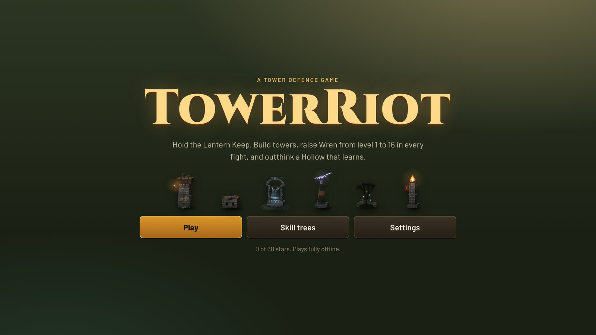
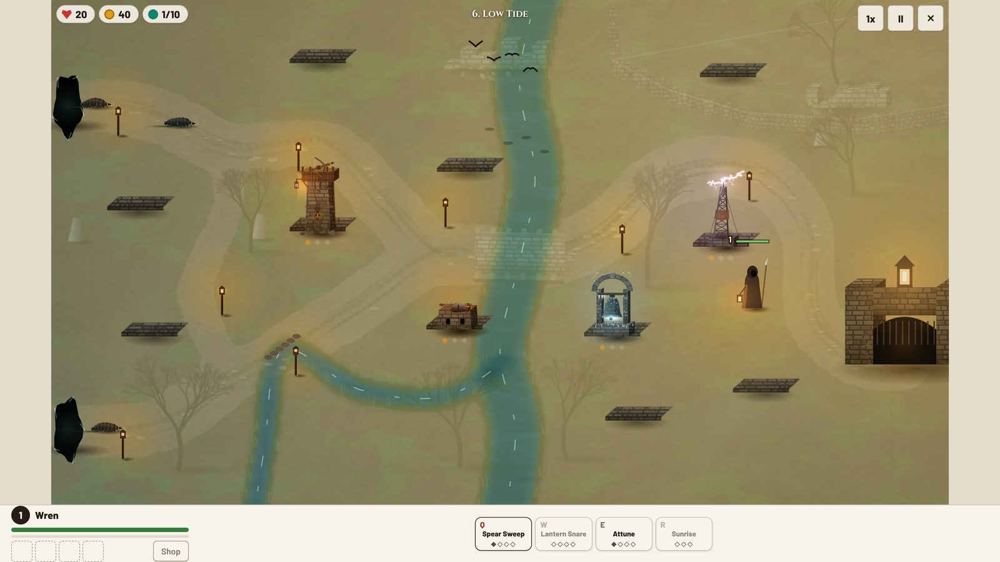
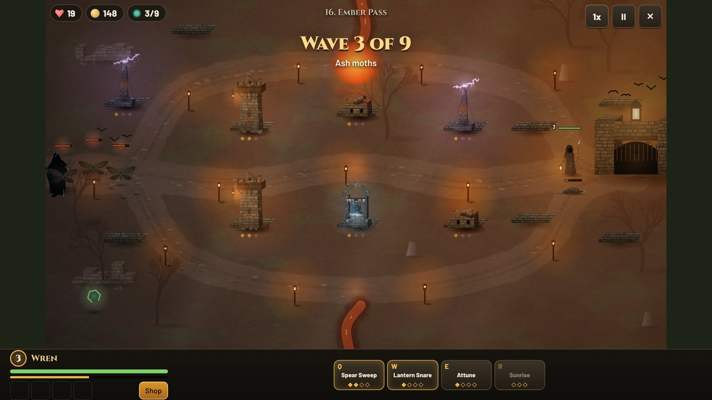
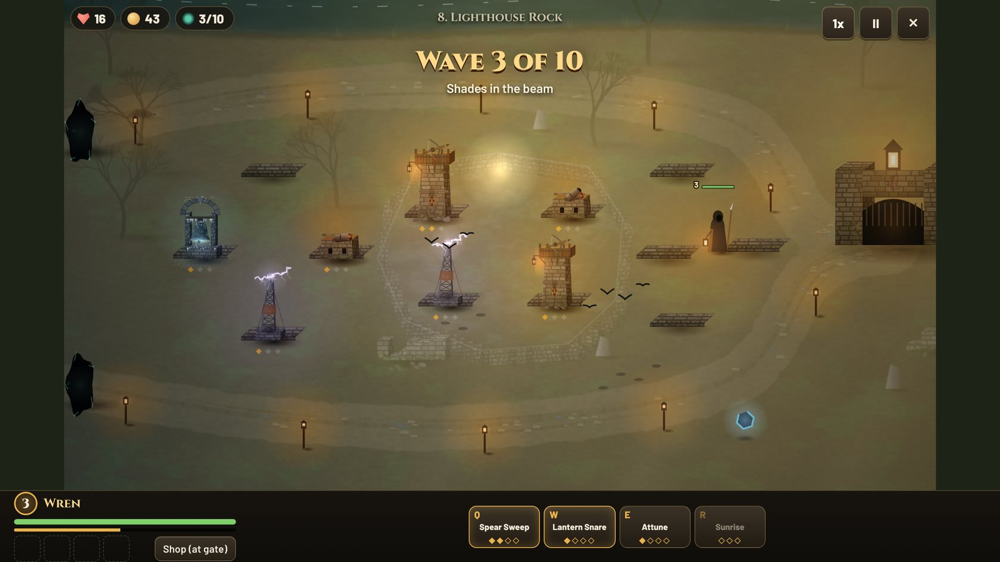
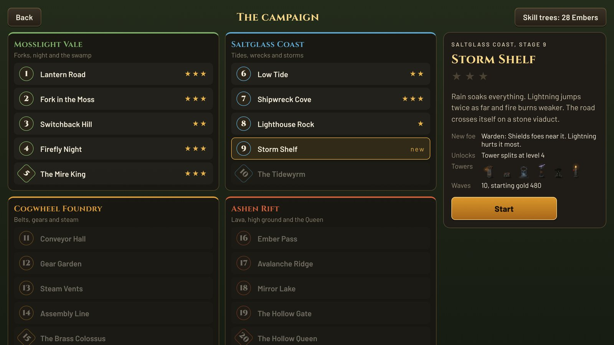
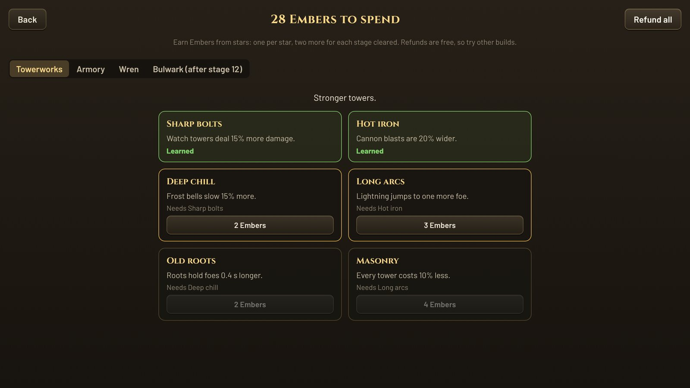
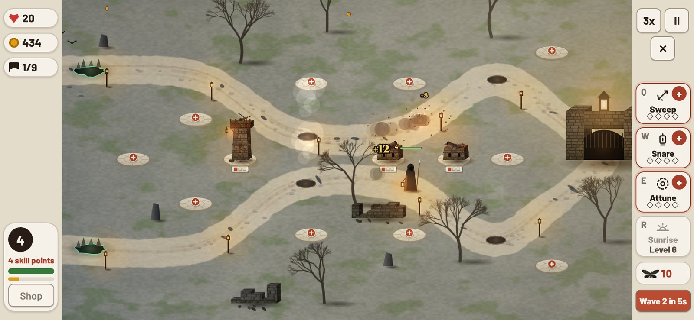

# TowerRiot

**Hold the Lantern Keep.** Build towers on stone plots, raise your hero Wren from level 1 to 16 in every fight, steal last hits for gold, grab runes, and outthink a Hollow that learns which towers you lean on.

TowerRiot is a classic tower defence game with a hero you control. It runs in any browser, on phones and tablets, and as a native app on iOS and Android. Once loaded, it never needs the internet again.

**Play it now: [njarrar.github.io/TowerRiot](https://njarrar.github.io/TowerRiot/)**



---

## Why it is fun

- **Your hero grows in every match.** Wren starts each stage at level 1. Kill foes to level her up, then spend points on four skills: Q, W, E and R. By the boss wave she is a different fighter.
- **Last hits pay.** When Wren lands the killing blow, you earn 50% more gold. Towers soften the crowd, Wren takes the prize.
- **Shop at the gate.** Walk Wren home to buy boots, blades, plate and a spear of dawn. Four slots, so choose.
- **Runes on the map.** Every minute a rune glows somewhere on the field: haste, double damage, regeneration or bounty. Is it worth leaving your post?
- **Foes think.** At every fork, each foe weighs how much fire waits down each road and picks the safer one. Stack every tower on one lane and the swarm walks the other.
- **The Hollow adapts.** In later stages, the enemy grows resistant to the element you use most. Mix fire, frost, storm, nature and steel or pay for it.
- **Every map changes as you play.** Tides close fords, lava floods passes, sappers chew through wrecks, belts speed foes up, plots sink, night falls.



---

## Wren, the hero

Tap the ground to move her. She holds that spot and blocks up to two foes. Tap a foe to send her after it. If she falls, she returns to the gate after a few seconds.

| Key | Skill | What it does |
|---|---|---|
| **Q** | Spear Sweep | Spins her spear and hits every foe around her. |
| **W** | Lantern Snare | Throws a lantern. Foes where it lands are held in place and burned. |
| **E** | Attune | Passive. Towers near Wren attack faster. |
| **R** | Sunrise | Every tower fires twice as fast, and every hidden foe shows. Opens at level 6. |

The gate works as her well: stand there to heal and to shop.

| Item | Cost | Effect |
|---|---|---|
| Clockwork boots | 60 | +40% move speed |
| Ring of moss | 80 | +7 health a second |
| Ember blade | 110 | +12 spear damage |
| Brass lantern | 120 | Lights hidden foes from further away |
| Warden's plate | 150 | +260 health, 20% less damage taken |
| Cleaving spear | 260 | Strikes also hit foes beside the target |
| Spear of dawn | 380 | +30 damage and 25% faster strikes |
| Second dawn | 420 | The first time Wren falls, she stands right back up |



---

## Six towers, twelve paths

Each tower has three levels. At the top, split it into one of two forms.

| Tower | Role | Split A | Split B |
|---|---|---|---|
| **Watch tower** | Fast, long range bolts | Longbow spire: more range, crits | Repeater: twice the fire rate |
| **Forge cannon** | Shells that burst on the road | Siege mortar: range and damage | Scatter gun: three shells a shot |
| **Frost bell** | A pulse that slows everything near it | Glacier: freezes foes solid | Chime: slowed foes take more damage |
| **Storm pylon** | Lightning that jumps between foes | Tesla crown: three more jumps | Rail: one huge bolt |
| **Root garden** | Thorns that hold a foe in place | Bramble: holds a whole group | Spore pod: a poison cloud |
| **Beacon** | No attack. Boosts nearby towers and reveals Shades | War drum: faster towers nearby | Watchfire: longer range nearby |

Set each tower to aim at the foe furthest along, the strongest or the closest. Load the Armory's ember, frost or storm rounds for extra effects.

---

## Know your foes

| Foe | Watch out |
|---|---|
| Grub | Slow and soft. Comes in crowds. |
| Skitter | Very fast and frail. Fire struggles to catch it. |
| Shellback | Bolts do half damage, fire cracks it. |
| Moth | Flies. Cannons and roots cannot reach it. |
| Warden | Shields foes near it. Lightning hurts it most. |
| Mender | Heals foes around it. Kill it first. |
| Shade | Unseen until a Beacon or Wren lights it. |
| Splitter | Bursts into three Skitters when it dies. |
| Sapper | Chews through wrecks and walls to open new roads. |
| Burrower | Digs under the road where nothing can reach it. |
| Ash moth | Flies and cannot burn. Frost brings it down. |
| Iron Shellback | Armored. Small hits barely scratch it. |

And four bosses, one at the end of each region: **The Mire King**, **The Tidewyrm**, **The Brass Colossus** and **The Hollow Queen**.



---

## The campaign: 20 stages, 4 regions



| Region | Its rules | Stages |
|---|---|---|
| **Mosslight Vale** | Forks, night and the swamp | 1 Lantern Road, 2 Fork in the Moss, 3 Switchback Hill, 4 Firefly Night, 5 The Mire King |
| **Saltglass Coast** | Tides, wrecks and storms | 6 Low Tide, 7 Shipwreck Cove, 8 Lighthouse Rock, 9 Storm Shelf, 10 The Tidewyrm |
| **Cogwheel Foundry** | Belts, gears and steam | 11 Conveyor Hall, 12 Gear Garden, 13 Steam Vents, 14 Assembly Line, 15 The Brass Colossus |
| **Ashen Rift** | Lava, high ground and the Queen | 16 Ember Pass, 17 Avalanche Ridge, 18 Mirror Lake, 19 The Hollow Gate, 20 The Hollow Queen |

Every stage brings a new foe or a new twist. Earn up to three stars on each by keeping the Keep's lives. Beat a boss to win a relic that stays with you.

---

## Skill trees



Stars earn Embers. Spend them across four trees between stages. Refunds are free, so try other builds.

- **Towerworks**: sharper bolts, wider blasts, deeper chill, cheaper towers.
- **Armory** (after stage 7): ember, frost and storm rounds, Shatter and Overload combos, faster reloads.
- **Wren** (after stage 2): stronger sweeps, richer last hits, a longer snare, start at level 3.
- **Bulwark** (after stage 12): more lives, a war chest, better resale, interest on banked gold.

---

## Play anywhere, fully offline



- **Web and mobile web.** A service worker caches the whole game on first load, so it keeps working with no signal. Add it to your home screen and it opens full screen, like an app.
- **iOS and Android.** iOS is a native Swift app with every picture and sound inside it. Android wraps the web game with Capacitor, every file bundled inside. No server, no account, no ads, no network calls.
- **Phones, tablets and desktops.** The controls sit beside the map on wide screens and below it on short ones, and they keep clear of notches and rounded corners.
- **Saves stay on your device.**

### Controls

| Action | Touch | Keyboard and mouse |
|---|---|---|
| Build | Tap a stone plot | Click a plot, or 1 to 6 |
| Upgrade, split, aim, sell | Tap a tower | Click a tower |
| Move Wren | Tap the ground | Right click |
| Skills | Q W E R buttons | Q W E R |
| Next wave early (pays bonus gold) | Wave button | Space |
| Speed and pause | Buttons | F and P |
| Shop | Shop button at the gate | B |

---

## Run it

You need Node.js 20 or newer.

```bash
npm install
npm run dev        # play at http://localhost:5173
npm test           # unit tests, plus a bot that plays all 20 stages
npm run build      # typecheck, build to dist/, write the offline cache
npm run preview    # serve the built game
```

### Web release

Every push to `main` runs the tests, builds the game and publishes it to [GitHub Pages](https://njarrar.github.io/TowerRiot/) (`.github/workflows/pages.yml`).

### iOS app (native)

The iOS game is a native Swift app in `ios/`, with no web view. It plays the same 20 stages with the same rules and the same art, fully offline.

- `ios/TowerRiotKit` is a Swift package with the battle engine, the game data and saves. It builds and tests on any machine with Swift: `cd ios/TowerRiotKit && swift test`. A test plays every stage with the same bot as the web tests and checks that both engines get the very same results.
- `ios/TowerRiot` is the app: SpriteKit draws the battle, SwiftUI draws the menus, and a small synth makes the sounds. Open `ios/TowerRiot/TowerRiot.xcodeproj` in Xcode 16 or newer and run.
- The web game stays the one source for numbers and art. After changing them, run:

```bash
npm run native:data   # write the towers, foes, stages and trees for Swift
npm run native:art    # paint the sprites, maps and menu pictures for the iOS app
```

The art step paints with the same painters the web game uses (`src/art/lfx.js`), in a headless browser, so both games always look alike. Every push that touches `ios/` builds the app and runs the Swift tests on a Mac (`.github/workflows/ios.yml`).

### Android app

```bash
npm run cap:android   # build, sync and open Android Studio
```

The app locks to landscape. Run `npm run icons` to repaint the app icon (Wren and the Keep) for the web, iOS and Android.

---

## How it is built

- **TypeScript and Vite**, no game engine. The map and every unit draw to a single canvas.
- **A headless battle engine** (`src/game/sim.ts`) with a seeded random source and fixed time steps, so the same moves always give the same result. The screen only reads its events.
- **Balance tested by a bot.** `tests/balance.test.ts` plays every stage with a simple strategy and fails if any stage can't be won.
- **Map checks.** `tests/stages.test.ts` makes sure no plot sits on a road or in water and no tide closes every road at once.
- **Painted art in code.** The ground of each stage is painted once when it loads, then towers, foes, light and weather draw on top every frame.
- **Sound made on the fly** with the Web Audio API. No sound files to download.

```
src/
  game/        battle engine, saves, upgrade maths
    data/      towers, foes, waves, the 20 stages, hero, shop, trees
  render/      the canvas scene and effects
  art/         the painting library
  ui/          title, campaign, trees, settings and the battle screen
  audio/       sound
tests/         stage checks and the balance bot
scripts/       offline cache, app icons, landscape lock, iOS art bake
tools/bake/    the page that paints the iOS art
ios/           the native iOS app (Swift) and its engine package
android/       Android app shell
```

---

## Design notes

The full design, from the three planning angles of level design, play and art, lives in [docs/DESIGN.md](docs/DESIGN.md).
